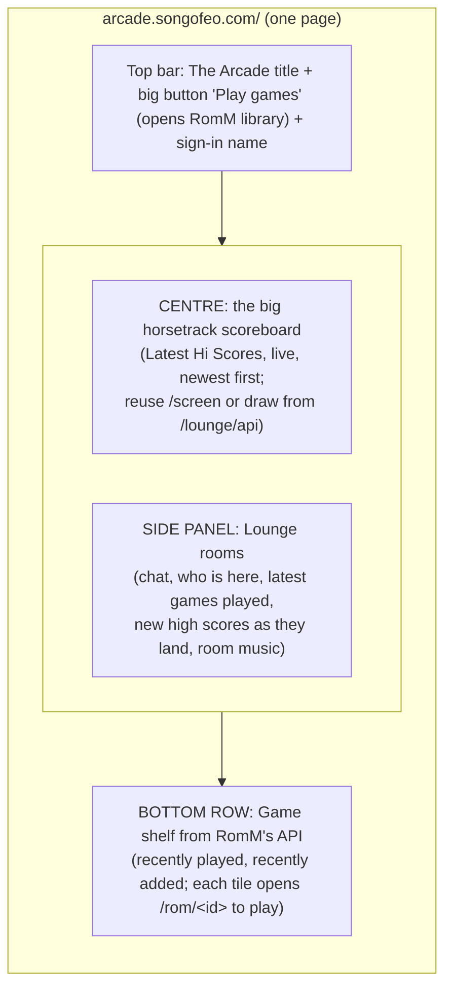

# The Arcade landing page: RomM + the big scoreboard on one page (DRAFT, 2026-11-28)

Addendum to Grok's brief `GROK-HANDOFF-high-scorers-lounge-2026-11-27.md`. It does **not** replace any part of that brief. Grok still builds the High Scorers Lounge app (backup API first, then Latest Hi Scores, then lounge rooms). This file only settles three things the owner asked on 2026-11-28:

1. How RomM and the scoreboard become **one** web landing page.
2. How `arcade.` and `hiscores.` route, so the Multi-Pass can link straight to the scoreboard.
3. Whether RomM needs its own copy of the ROMs, and where each `hiscore.dat` comes from.

Checked against RomM docs (docs.romm.app, 5.4.x) and our pinned RomM 5.4.1 (`docs/VERSIONS.md`) on 2026-11-28.

## Owner's words (2026-11-28)

> The scoreboard page should be easily accessible/linked to the arcade page so users can't ignore the big horsetrack scoreboard when they enter the arcade. The scoreboard page already is supposed to have lounge room chats as a side panel, so really the romm and scoreboard page should just be the same landing page on the web. The redirects will still be needed so that users can see the scoreboard easily from their Multi-Pass.

## Decision 1: one landing page at `https://arcade.songofeo.com/`

RomM has to own the root of its host name. Its docs only show it served at the root of a name (`romm.mysite.com`, `ROMM_BASE_URL` = that name) and give no sub-folder option, so RomM can't move to `arcade.songofeo.com/romm/`. Instead, the gate's nginx hands **only the bare front door** to the lounge app and everything else to RomM:

| Request on `arcade.songofeo.com` | Goes to | Why |
|---|---|---|
| exactly `/` (a fresh visit, a bookmark, the Multi-Pass "Enter" button) | Lounge app (gate; `127.0.0.1:8090` if Grok builds it into the hiscore server, else its own port) | Everyone entering the Arcade lands on the scoreboard first |
| `/lounge/...` (its page files, its API, its chat socket) | Lounge app | `/lounge` is not a path RomM uses |
| everything else (`/api`, `/assets`, `/ws`, `/rom/<id>`, `/platform/<id>`, `/login`, ...) | RomM (SGIN `10.6.9.20:8080`) | RomM works exactly as it does today |

Because both halves live on the same name, they share the gate sign-in cookie, the lounge needs no CORS rules, and the lounge can link to any RomM page with a plain link. RomM's own menu still works inside RomM (its router changes pages without a reload); only a fresh load of `/` shows the lounge.

### What the landing page shows (layout)



- **Centre:** the scoreboard, as big as the screen allows. It is the first thing anyone sees. On a phone it fills the screen and the side panel becomes a "Lounge" tab below it.
- **Side panel:** the lounge rooms from Grok's brief (unchanged).
- **Bottom row, the Game shelf:** a short row of game tiles from RomM's API (recently played and recently added). Each tile links to RomM's own game page (`/rom/<id>`), where the player presses Play. Read it with a RomM **Client API Token** (RomM: Administration, Client API Tokens; scopes `roms.read`, `platforms.read`, `roms.user.read`). Recently played comes from `GET /api/play-sessions` (scope `roms.user.read`). Never read RomM's MariaDB directly.
- **Do not put RomM in an iframe** on this page. RomM's own reverse-proxy guide sets `X-Frame-Options: SAMEORIGIN`, which would allow it, but RomM in a box is cramped on a phone and EmulatorJS wants the full window. Link to it instead.
- **Getting back to the lounge from RomM:** a fresh load of `https://arcade.songofeo.com/` (the browser's address bar, the Multi-Pass, or RomM's logo after a refresh). An injected "Back to the Lounge" strip inside RomM's own pages is possible later with nginx `sub_filter`, but it can break on any RomM update, so it is **not** part of day one.
- Look: crude placeholders only. The owner hand-draws the final art. No glow or texture layers, no paid assets.
- Accessibility: every form in the lounge (sign-up, claim a score, report a wrong score, room settings) goes through Formidable Flow, one question at a time, ADA Title II ready. The scoreboard needs a text version a screen reader can read (a plain table of game, rank, initials, score), not only the animated board.

## Decision 2: names and redirects

| Name | Front door (`/`) | Other paths | Used by |
|---|---|---|---|
| `arcade.songofeo.com` | Lounge landing page (scoreboard centre) | `/lounge/` = lounge app; everything else = RomM | Multi-Pass "Arcade" Bay, everyone |
| `hiscores.songofeo.com` | **302 redirect** to `https://arcade.songofeo.com/#scoreboard` | `/upload/`, `/api/`, `/public/`, `/screen`, `/healthz` stay on the hiscore server exactly as today | Multi-Pass "Scoreboard" link (redirect), the cabinet agent and LaunchBox plugin (uploads), big screens (`/screen`) |
| `scores.songofeo.com` | retired (`NGINX-NAMES-2026-11-28.md`) | – | – |

So the Multi-Pass can use either `https://hiscores.songofeo.com` or `https://arcade.songofeo.com/#scoreboard`; both land on the same page with the scoreboard in view. Both names stay behind the gate sign-in (Authelia, any signed-in person). Uploads from the cabinet keep using their Bearer key; the nginx/Authelia rule that lets `/upload/` through with a key stays as manual part 7 has it.

**Rename to finish (small, for Grok or Claude):** the cabinet agent and LaunchBox plugin still default to `https://scores.songofeo.com` (`apps/hiscore-agent/config.example.json`, `apps/hiscore-launchbox`, their READMEs and tests). Change the default to `https://hiscores.songofeo.com`. On the cabinet itself, the owner edits one line in `C:\Cobra\hiscore-agent\config.json`; nothing else changes and no stored score is touched.

### nginx sketch for the gate (`/srv/gate/nginx/conf.d/songofeo.conf`)

For Grok to finish and test; not for the owner to paste yet. Keep the existing Authelia `auth_request` lines from the current `arcade.` and `hiscores.` blocks.

```nginx
# arcade.songofeo.com: lounge at the front door, RomM for everything else
location = / {
    proxy_pass http://127.0.0.1:8090/lounge/;
}
location /lounge/ {
    proxy_pass http://127.0.0.1:8090;
    proxy_http_version 1.1;
    proxy_set_header Upgrade $http_upgrade;
    proxy_set_header Connection "upgrade";
}
location / {
    proxy_pass http://10.6.9.20:8080;
    client_max_body_size 0;
    proxy_http_version 1.1;
    proxy_set_header Upgrade $http_upgrade;
    proxy_set_header Connection "upgrade";
}
```

```nginx
# hiscores.songofeo.com: front door redirects, the API stays
location = / {
    return 302 https://arcade.songofeo.com/#scoreboard;
}
```

## Decision 3: ROMs. RomM keeps the nightly copy it already has; no third copy

The owner says the cabinet's ROMs are in `cobra-storage\roms`. We read that as the cabinet's own ROM drive (manual part 4 calls it `D:\Roms`, the main copy). **To confirm with the owner:** is `cobra-storage` that drive's label, or a different share?

| Copy | Where | Who uses it |
|---|---|---|
| 1. Main copy | Cabinet `cobra-arcade`, `cobra-storage\roms` (`D:\Roms`) | LaunchBox, Big Box, RetroArch |
| 2. Nightly copy | SGIN `dock1b/roms` (share `\\cobra-stream\roms`), robocopy `/E /XO`, never deletes | RomM (mounted as `/romm/library/roms`) **and** the ROMs' backup |

- RomM **does need a copy on the SGIN**: it can't read a disk inside the cabinet, and the web arcade has to work while the cabinet is off. That copy already exists (copy 2). No new copy is needed.
- **Mount it read-only in RomM** (`-v "$POOL/roms:/romm/library/roms:ro"` in `scripts/podman/sgin/romm.sh`). RomM's own docs recommend read-only for a curated library. Copy 2 is also the ROM backup, so the web app should not be able to change it. RomM keeps its own covers, saves and states in its separate `resources` and `assets` folders, which stay read-write. The cost: RomM's web "Upload ROM" button stops working. That matches the house rule already in manual part 4 (add ROMs on the cabinet; the copy runs cabinet to SGIN only). `VOLUME-PATHS-2026-11-28.md` lists this mount as read-write; change it to read-only when this lands. Changing the mount flag moves or deletes nothing.
- Same romset on both sides: the browser arcade and the cabinet run the same FinalBurn Neo / MAME 2003-Plus romsets (manual part 4), so a game's `.hi` file and its `hiscore.dat` mean the same thing on both.

## Decision 4: both sides' `hiscore.dat` go to the scoreboard

This extends priority 1 of Grok's brief (the day-one backup). Every upload is a new version; nothing is ever replaced.

| Source | Files | Uploaded by | Stored as |
|---|---|---|---|
| Cabinet (RetroArch cores) | each core's `C:\RetroArch-Win64\system\<core>\hiscore.dat`, plus every `*.hi` | hiscore agent (every 15 s) and the LaunchBox plugin (on game exit) | `PUT /upload/<core>/hiscore.dat`, `PUT /upload/<core>/<game>.hi` (source `cabinet`) |
| RomM's browser arcade (EmulatorJS) | the `hiscore.dat` each browser core uses, plus `.hi` files once the browser upload exists | a one-time upload by the owner (or a small script on the SGIN) for the `.dat`; the browser `.hi` upload is still the research item in Grok's brief | `PUT /upload/web-<core>/hiscore.dat` (source `web`), so the two never overwrite each other's history |

- If the browser cores and the cabinet cores turn out to use the very same `hiscore.dat` (same bytes), the server records that, and both sources point to the one version. Compare by hash; don't guess.
- The scoreboard shows one board. Each score row notes where it was set (cabinet or browser), so nobody mistakes a browser score for a cabinet one.
- Restore path (already in Grok's brief) covers both sources: a zip of every `.hi` and `hiscore.dat` version for one game or one core.

## Open questions for the owner

1. `cobra-storage\roms`: the cabinet's ROM drive (`D:\Roms`), or something else?
2. OK to make RomM's ROM folder read-only (no web uploads; ROMs are added on the cabinet only)?

## House rules that apply

Never overwrite data. Check RomM, Authelia and nginx release notes before using a setting. Owner run steps follow `docs/style/README-RULES.md`. Work on a branch, open a PR, don't merge without the owner's yes.
